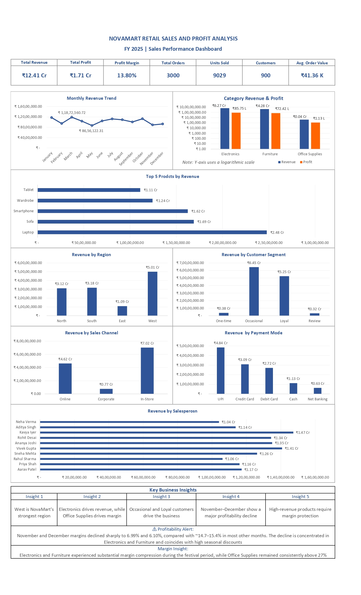
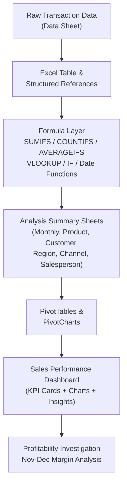
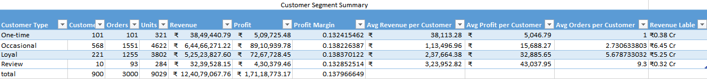
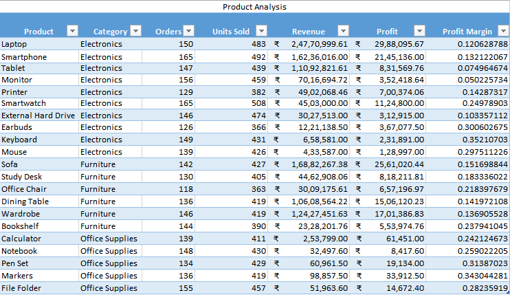
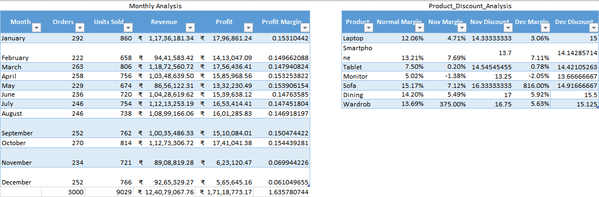

# NovaMart Retail Sales & Profit Analysis Dashboard

> **An end-to-end Microsoft Excel business analytics project that converts 3,000 retail transactions into a consolidated, interactive dashboard delivering actionable insights on revenue, profitability, customers, products, regions, sales channels, and seasonal performance.**



---

## Table of Contents

1. [Project Overview](#1-project-overview)
2. [Business Problem](#2-business-problem)
3. [Dataset Description](#3-dataset-description)
4. [Tools & Excel Techniques](#4-tools--excel-techniques)
5. [Workbook Architecture & Workflow](#5-workbook-architecture--workflow)
6. [Analysis Modules](#6-analysis-modules)
7. [Dashboard Features](#7-dashboard-features)
8. [Key Business Insights & Results](#8-key-business-insights--results)
9. [Profitability Investigation](#9-profitability-investigation)
10. [Screenshots](#10-screenshots)
11. [Project Directory Structure](#11-project-directory-structure)
12. [How to Open & Use the Dashboard](#12-how-to-open--use-the-dashboard)
13. [Reproducing the Analysis](#13-reproducing-the-analysis)
14. [Limitations & Future Improvements](#14-limitations--future-improvements)
15. [Acknowledgements](#15-acknowledgements)

---

## 1. Project Overview

**NovaMart Retail Sales & Profit Analysis Dashboard** is a self-contained Microsoft Excel business intelligence project built for a fictional retail company, NovaMart.

The project transforms raw, transaction-level sales records into a structured analytical workbook that answers real business questions about revenue drivers, profit performance, customer behaviour, product profitability, regional distribution, sales channel effectiveness, and the impact of seasonal discounting on margins.

The entire pipeline — from raw data ingestion through formula-driven calculations, PivotTable-based aggregation, and final dashboard visualisation — is built exclusively inside Microsoft Excel without any external tools or programming languages.

### Target Audience

| Audience | How the Project Is Useful |
|---|---|
| Business analysts | Reference implementation of Excel-based retail analytics |
| Students & learners | Practical showcase of Excel formulas, PivotTables, and dashboard design |
| Retail managers | Template adaptable to real business sales data |
| Portfolio reviewers | Demonstration of end-to-end analytical thinking and Excel proficiency |

---

## 2. Business Problem

Analysing thousands of individual retail transactions directly makes it difficult to identify patterns, outliers, and performance drivers. NovaMart's management needs rapid answers to strategic questions without manually sifting through raw records.

The project addresses the following business questions:

- Which products and categories generate the most revenue and profit?
- Which products have weak or negative profitability?
- Which regions and cities are the strongest and weakest performers?
- Which customer segments contribute most to revenue and profit?
- How do Online, In-Store, and Corporate sales channels compare?
- Which payment methods are most frequently used?
- How does business performance change across the 12 months of 2025?
- What caused the sharp decline in profit margins during November and December?
- Are seasonal discounts associated with margin compression?

---

## 3. Dataset Description

### Source & Scope

The project uses a structured, synthetic retail transaction dataset covering the full fiscal year 2025 (January–December).

> **Note:** The raw dataset is embedded within the Excel workbook (`Dashboard/NovaMart_Retail_Sales_Dashboard.xlsx`) and is not distributed as a separate CSV or database file.

### Dataset Summary

| Attribute | Value |
|---|---|
| Total Transactions | 3,000 |
| Total Customers | 900 |
| Total Products | 21 |
| Product Categories | 3 (Electronics, Furniture, Office Supplies) |
| Regions | 4 (North, South, East, West) |
| Cities | 12 |
| Sales Channels | 3 (Online, In-Store, Corporate) |
| Payment Modes | 5 (UPI, Credit Card, Debit Card, Cash, Net Banking) |
| Salespersons | 10 |
| Time Period | January 2025 – December 2025 |

### Transaction-Level Fields

Each record in the dataset contains the following information:

| Field | Description |
|---|---|
| Order Date | Date of the transaction |
| Customer ID / Name | Unique customer identifier and name |
| Customer Type | Segment: One-time, Occasional, Loyal, or Review |
| Product | Product name |
| Category | Electronics, Furniture, or Office Supplies |
| Region | North, South, East, or West |
| City | One of 12 cities |
| Salesperson | Name of the assigned salesperson |
| Sales Channel | Online, In-Store, or Corporate |
| Payment Mode | UPI, Credit Card, Debit Card, Cash, or Net Banking |
| Quantity | Number of units sold |
| Revenue | Total revenue for the transaction |
| Cost | Total cost for the transaction |
| Profit | Revenue minus Cost |
| Season | Season label (used to flag festival-period transactions) |
| Discount | Discount applied to the transaction (used in profitability investigation) |

### Products by Category

| Category | Products |
|---|---|
| **Electronics** | Laptop, Smartphone, Tablet, Monitor, Printer, Smartwatch, External Hard Drive, Earbuds, Keyboard, Mouse |
| **Furniture** | Sofa, Study Desk, Office Chair, Dining Table, Wardrobe, Bookshelf |
| **Office Supplies** | Calculator, Notebook, Pen Set, Markers, File Folder |

---

## 4. Tools & Excel Techniques

### Tools

| Tool | Role |
|---|---|
| **Microsoft Excel** | Sole tool used for data storage, computation, analysis, and visualisation |

### Excel Techniques Applied

#### Data Organisation
- **Excel Tables** with structured references for dynamic formula ranges
- **Data Validation** to ensure data integrity
- **Data reconciliation** to verify totals across sheets

#### Formula-Driven Calculations

| Formula / Function | Purpose |
|---|---|
| `SUMIFS` | Conditional aggregation of revenue, profit, and units by multiple criteria |
| `COUNTIFS` | Counting transactions by category, region, channel, segment, and period |
| `AVERAGEIFS` | Computing average order values and average margins under multiple conditions |
| `VLOOKUP` | Cross-referencing product and customer attributes |
| `IF / AND / OR` | Logical flags for customer type classification and seasonal identification |
| Date functions | Extracting month and season from order dates for time-series analysis |

#### Aggregation & Analysis
- **PivotTables** — Core aggregation engine for all analytical summaries
- **PivotCharts** — Dynamic visualisations linked to PivotTables
- **Conditional Formatting** — Highlighting performance outliers and trends

#### KPI Calculations
- Total Revenue, Total Profit, Profit Margin
- Total Orders, Units Sold, Customer Count
- Average Order Value (AOV)
- Revenue and Profit per Customer Segment
- Monthly and seasonal margin comparisons

#### Dashboard Design
- **KPI Card layout** for headline metrics
- **Combination charts** (column + line) for trend analysis
- **Logarithmic-scale chart** for category revenue and profit comparison
- **Horizontal bar charts** for product and salesperson rankings
- **Segment and regional breakdowns** using clustered charts
- **Key insights panel** summarising findings

---

## 5. Workbook Architecture & Workflow

### High-Level Workflow



### Data Flow Description

1. **Raw Data Sheet** — Contains the 3,000 transaction records as an Excel Table. All downstream calculations reference this table using structured references, ensuring formulas remain valid if rows are added or removed.

2. **Formula Layer** — Dedicated calculation sheets use `SUMIFS`, `COUNTIFS`, `AVERAGEIFS`, and `VLOOKUP` to build summary tables broken down by month, product, category, region, customer segment, salesperson, sales channel, payment mode, and season.

3. **Analysis Summary Sheets** — Structured summary tables (Monthly Analysis, Product Analysis, Customer Segment Summary, Regional Analysis, Salesperson Analysis, Channel Analysis, Payment Mode Analysis) feed both the dashboard and standalone analysis views.

4. **PivotTables & PivotCharts** — Used for dynamic cross-tabulation and chart generation. Charts are linked directly to PivotTables, meaning they update automatically when data changes.

5. **Dashboard Sheet** — A consolidated, single-screen view presenting KPI cards, trend charts, breakdowns, and key insight panels side by side.

6. **Profitability Investigation** — A dedicated analytical section that isolates November and December performance, compares normal-period margins against festival-period margins at the product level, and cross-references discount levels.

---

## 6. Analysis Modules

The project is structured around the following analytical areas:

### 6.1 Overall Sales Performance
Headline KPI metrics covering the full year:
- Total Revenue, Total Profit, Profit Margin
- Total Orders, Units Sold, Unique Customers
- Average Order Value

### 6.2 Monthly Performance Analysis
Month-by-month breakdown of:
- Revenue and Profit per month
- Units Sold and Order Count
- Monthly Profit Margin trend
- Identification of seasonal anomalies (November and December)

### 6.3 Product Analysis
All 21 products evaluated on:
- Revenue, Profit, Units Sold, Orders, Profit Margin
- Ranking by revenue and by profitability
- Identification of low-margin and loss-making products

### 6.4 Category Analysis
Three-category comparison (Electronics, Furniture, Office Supplies) across:
- Revenue and Profit contribution
- Category-level margin comparison
- Logarithmic-scale visualisation to make small-category values visible

### 6.5 Customer Analysis
- Four-segment breakdown: One-time, Occasional, Loyal, Review
- Metrics per segment: Customers, Orders, Units, Revenue, Profit, Margin
- Average Revenue per Customer and Average Orders per Customer
- Top customer identification by revenue and profit

### 6.6 Regional & City Analysis
- Revenue and Profit by Region (North, South, East, West)
- City-level breakdown within regions
- Identification of strongest and weakest performing geographies

### 6.7 Salesperson Performance
- Revenue, Profit, Margin, Orders, Units, and AOV per salesperson
- Ranking of salespersons by revenue and profit contribution

### 6.8 Sales Channel Analysis
- Performance comparison across Online, In-Store, and Corporate channels
- Revenue, Profit, and Margin by channel

### 6.9 Payment Mode Analysis
- Revenue and Profit broken down by UPI, Credit Card, Debit Card, Cash, and Net Banking

### 6.10 Seasonal Analysis
- Comparison of regular-period versus festival-period (November–December) performance
- Margin impact of seasonal discounting

### 6.11 Profitability Investigation
- Deep-dive into November and December margin decline
- Product-level margin comparison: normal vs. November vs. December
- Cross-reference with discount levels applied during those months
- Identification of loss-making products

---

## 7. Dashboard Features

The Sales Performance Dashboard presents all analytical outputs on a single consolidated screen within the workbook.

### KPI Cards (Top Row)

Seven headline metrics displayed prominently:

| KPI | Value |
|---|---|
| Total Revenue | ₹12.41 Cr |
| Total Profit | ₹1.71 Cr |
| Profit Margin | 13.80% |
| Total Orders | 3,000 |
| Units Sold | 9,029 |
| Customers | 900 |
| Avg. Order Value | ₹41.36 K |

### Charts Included

| Chart | Type | What It Shows |
|---|---|---|
| Monthly Revenue Trend | Line chart | Revenue across all 12 months |
| Category Revenue & Profit | Clustered column (log scale) | Revenue and profit comparison across 3 categories |
| Top 5 Products by Revenue | Horizontal bar | Highest-revenue products |
| Revenue by Region | Clustered column | Regional revenue distribution |
| Revenue by Customer Segment | Clustered column | Segment-wise revenue |
| Revenue by Sales Channel | Clustered column | Channel-wise revenue |
| Revenue by Payment Mode | Clustered column | Payment method distribution |
| Revenue by Salesperson | Horizontal bar | All 10 salespersons ranked by revenue |

### Key Business Insights Panel

Five summarised insights displayed at the bottom of the dashboard, followed by:
- **Profitability Alert** — November and December margin warning with context
- **Margin Insight** — Category-level margin comparison during festival vs. normal periods

---

## 8. Key Business Insights & Results

All metrics below are sourced directly from the workbook and verified against the screenshots.

### Overall Performance

| Metric | Value |
|---|---|
| Total Revenue | ₹12,40,79,067.76 |
| Total Profit | ₹1,71,18,773.17 |
| Profit Margin | 13.80% |
| Total Orders | 3,000 |
| Units Sold | 9,029 |
| Unique Customers | 900 |
| Average Order Value | ₹41,359.69 |

### Category Performance

| Category | Revenue | Profit | Profit Margin |
|---|---:|---:|---:|
| Electronics | ₹6.27 Cr | ₹85.75 L | ~13.68% |
| Furniture | ₹4.28 Cr | ₹72.42 L | ~16.92% |
| Office Supplies | ₹0.04 Cr | ₹1.13 L | ~27.62% |

> **Insight:** Electronics drives the largest share of revenue (~59.5%), Furniture is the second-largest contributor (~40.1%), and Office Supplies is a very small category by revenue (~0.4%) but achieves the highest profit margin (~27.62%).

### Product Performance (All 21 Products)

| Product | Category | Orders | Units Sold | Revenue | Profit | Profit Margin |
|---|---|---:|---:|---:|---:|---:|
| Laptop | Electronics | 150 | 483 | ₹2,47,70,999.61 | ₹29,88,095.67 | 12.06% |
| Smartphone | Electronics | 165 | 492 | ₹1,62,36,016.00 | ₹21,45,136.00 | 13.21% |
| Sofa | Furniture | 142 | 427 | ₹1,68,82,267.38 | ₹25,61,020.44 | 15.17% |
| Dining Table | Furniture | 136 | 419 | ₹1,06,08,564.22 | ₹15,06,120.23 | 14.20% |
| Tablet | Electronics | 147 | 439 | ₹1,10,92,821.61 | ₹8,31,569.76 | 7.50% |
| Wardrobe | Furniture | 146 | 419 | ₹1,24,27,451.63 | ₹17,01,386.83 | 13.69% |
| Monitor | Electronics | 156 | 459 | ₹70,16,694.72 | ₹3,52,418.64 | 5.02% |
| Printer | Electronics | 129 | 382 | ₹49,02,068.46 | ₹7,00,374.06 | 14.29% |
| Smartwatch | Electronics | 165 | 508 | ₹45,03,000.00 | ₹11,24,800.00 | 24.98% |
| External Hard Drive | Electronics | 146 | 474 | ₹30,27,513.00 | ₹3,12,915.00 | 10.34% |
| Earbuds | Electronics | 126 | 366 | ₹12,21,138.50 | ₹3,67,077.50 | 30.06% |
| Keyboard | Electronics | 149 | 431 | ₹6,58,581.00 | ₹2,31,891.00 | 35.21% |
| Mouse | Electronics | 139 | 426 | ₹4,33,587.00 | ₹1,28,997.00 | 29.75% |
| Study Desk | Furniture | 130 | 405 | ₹44,62,908.06 | ₹8,18,211.81 | 18.33% |
| Office Chair | Furniture | 118 | 363 | ₹30,09,175.61 | ₹6,57,196.97 | 21.84% |
| Bookshelf | Furniture | 144 | 390 | ₹23,28,201.76 | ₹5,53,974.76 | 23.79% |
| Calculator | Office Supplies | 139 | 411 | ₹2,53,799.00 | ₹61,451.00 | 24.21% |
| Notebook | Office Supplies | 148 | 430 | ₹32,497.60 | ₹8,417.60 | 25.90% |
| Pen Set | Office Supplies | 134 | 429 | ₹60,961.50 | ₹19,134.00 | 31.39% |
| Markers | Office Supplies | 136 | 419 | ₹98,857.50 | ₹33,912.50 | 34.30% |
| File Folder | Office Supplies | 155 | 457 | ₹51,963.60 | ₹14,672.40 | 28.24% |

### Customer Segment Performance

| Customer Type | Customers | Orders | Units | Revenue | Profit | Profit Margin |
|---|---:|---:|---:|---:|---:|---:|
| Occasional | 568 | 1,551 | 4,622 | ₹6,44,66,271.22 | ₹89,10,398.78 | 13.82% |
| Loyal | 221 | 1,255 | 3,802 | ₹5,25,23,827.60 | ₹72,67,728.45 | 13.84% |
| One-time | 101 | 101 | 321 | ₹38,49,440.79 | ₹5,09,725.48 | 13.25% |
| Review | 10 | 93 | 284 | ₹32,39,528.15 | ₹4,30,379.46 | 13.29% |

> **Insight:** Occasional and Loyal customers together account for approximately 94.3% of total revenue.

### Regional Performance

| Region | Revenue |
|---|---:|
| West | ₹5.01 Cr (~40.4%) |
| South | ₹3.18 Cr (~25.6%) |
| North | ₹3.12 Cr (~25.1%) |
| East | ₹1.09 Cr (~8.8%) |

### Sales Channel Performance

| Channel | Revenue |
|---|---:|
| In-Store | ₹7.02 Cr (~56.6%) |
| Online | ₹4.62 Cr (~37.3%) |
| Corporate | ₹0.77 Cr (~6.2%) |

### Payment Mode Performance

| Payment Mode | Revenue |
|---|---:|
| UPI | ₹4.84 Cr |
| Credit Card | ₹3.09 Cr |
| Debit Card | ₹2.72 Cr |
| Cash | ₹1.13 Cr |
| Net Banking | ₹0.63 Cr |

### Monthly Performance

| Month | Orders | Units Sold | Revenue | Profit | Profit Margin |
|---|---:|---:|---:|---:|---:|
| January | 292 | 860 | ₹1,17,36,181.34 | ₹17,96,861.24 | 15.31% |
| February | 222 | 658 | ₹94,41,583.42 | ₹14,13,047.09 | 14.97% |
| March | 263 | 806 | ₹1,18,72,560.72 | ₹17,56,436.41 | 14.79% |
| April | 258 | 756 | ₹1,03,48,639.50 | ₹15,85,968.56 | 15.32% |
| May | 229 | 674 | ₹86,56,122.31 | ₹13,32,230.49 | 15.39% |
| June | 236 | 720 | ₹1,04,28,619.62 | ₹15,39,638.12 | 14.76% |
| July | 246 | 754 | ₹1,12,13,253.19 | ₹16,53,414.41 | 14.75% |
| August | 246 | 738 | ₹1,08,99,166.06 | ₹16,01,285.83 | 14.69% |
| September | 252 | 762 | ₹1,00,35,486.33 | ₹15,10,084.01 | 15.05% |
| October | 270 | 814 | ₹1,12,73,306.72 | ₹17,41,041.38 | 15.44% |
| **November** | **234** | **721** | **₹89,08,819.28** | **₹6,23,120.47** | **6.99%** |
| **December** | **252** | **766** | **₹92,65,329.27** | **₹5,65,645.16** | **6.10%** |

> **Notable Finding:** Profit margins for January through October remained consistently between approximately 14.7% and 15.4%. November and December show a dramatic compression to 6.99% and 6.10% respectively.

---

## 9. Profitability Investigation

A dedicated investigation was conducted after the monthly analysis revealed a sharp and unexpected decline in profit margins during November and December.

### Findings Summary

The investigation compared each product's normal profit margin (January–October average) against its performance in November and December, and cross-referenced these figures with the discount levels applied during each period.

| Product | Normal Margin | Nov Margin | Nov Discount | Dec Margin | Dec Discount |
|---|---:|---:|---:|---:|---:|
| Laptop | 12.06% | 4.71% | 14.33% | 3.06% | 15.00% |
| Smartphone | 13.21% | 7.69% | 13.70% | 7.11% | ~14.14% |
| Tablet | 7.50% | 0.20% | 14.55% | 0.78% | ~14.42% |
| Monitor | 5.02% | −1.38% | 13.25% | −2.05% | ~13.67% |
| Sofa | 15.17% | 7.12% | 16.33% | 8.16% | ~14.92% |
| Dining Table | 14.20% | 5.49% | 17.00% | 5.92% | 15.50% |
| Wardrobe | 13.69% | 3.75% | 16.75% | 5.63% | ~15.13% |

### Conclusion

The analysis identified that aggressive seasonal discounting during November and December was associated with substantial margin compression across high-revenue Electronics and Furniture products. The Monitor product became loss-making during both November (−1.38%) and December (−2.05%).

> **Business Recommendation:** The seasonal discount strategy requires a review to ensure that promotions generate sufficient incremental volume to offset the margin impact, particularly for high-revenue, low-baseline-margin products such as Monitor and Tablet.

---

## 10. Screenshots

### Main Dashboard


### Customer Segment Analysis


### Product Analysis


### Profitability Investigation


---

## 11. Project Directory Structure

```
NovaMart-Retail-Sales-Analysis/
|
+-- Dashboard/
|   +-- NovaMart_Retail_Sales_Dashboard.xlsx   # Main Excel workbook: data, analysis, dashboard
|   +-- NovaMart_Dashboard.pdf                 # PDF export of the dashboard (no Excel required)
|
+-- Documentation/
|   +-- NovaMart_Retail_Sales_Profit_Analysis_Documentation.docx
|                                              # Written analysis report: methodology and findings
|
+-- Screenshots/
|   +-- NovaMart_Dashboard.jpg                 # Full dashboard screenshot
|   +-- Customer_Segment_Analysis.png          # Customer segment summary table
|   +-- Product_Analysis.png                   # Product-level table (all 21 products)
|   +-- Profitability_Investigation.png        # Monthly analysis + Nov-Dec investigation table
|
+-- README.md                                  # This file
```

### File Descriptions

| File | Description |
|---|---|
| `Dashboard/NovaMart_Retail_Sales_Dashboard.xlsx` | Primary deliverable. Contains raw transaction data, all formula-driven summary sheets, PivotTables, PivotCharts, and the final dashboard. Open this file to interact with the full analysis. |
| `Dashboard/NovaMart_Dashboard.pdf` | Static PDF export of the dashboard for viewers who do not have Microsoft Excel installed. |
| `Documentation/NovaMart_Retail_Sales_Profit_Analysis_Documentation.docx` | Written documentation file detailing the project methodology, analysis approach, findings, and business recommendations. |
| `Screenshots/NovaMart_Dashboard.jpg` | Full-resolution screenshot of the main Excel dashboard. |
| `Screenshots/Customer_Segment_Analysis.png` | Screenshot of the customer segment summary table with all metrics per segment. |
| `Screenshots/Product_Analysis.png` | Screenshot of the product-level analysis table covering all 21 products. |
| `Screenshots/Profitability_Investigation.png` | Screenshot showing the monthly analysis and the November–December discount investigation side by side. |

---

## 12. How to Open & Use the Dashboard

### Prerequisites

| Requirement | Details |
|---|---|
| **Microsoft Excel** | Version 2016 or later recommended (for full PivotTable and chart compatibility) |
| **Operating System** | Windows or macOS with Microsoft Excel installed |
| **Alternative viewer** | Use `Dashboard/NovaMart_Dashboard.pdf` if Excel is not available (read-only, no interactivity) |

### Opening the Workbook

1. Clone or download this repository:
   ```bash
   git clone https://github.com/<your-username>/NovaMart-Retail-Sales-Analysis.git
   ```

2. Navigate to the `Dashboard/` folder.

3. Open `NovaMart_Retail_Sales_Dashboard.xlsx` in Microsoft Excel.

4. If prompted, click **Enable Content** or **Enable Editing** to allow formula recalculation and PivotTable functionality.

### Navigating the Workbook

Use the sheet tabs at the bottom of the Excel window to move between:

- **Data sheet** — Raw transaction records (3,000 rows)
- **Analysis sheets** — Formula-driven summary tables (Monthly, Product, Customer, Regional, Channel, Payment, Salesperson)
- **Dashboard sheet** — The consolidated single-screen business intelligence view
- **Profitability Investigation section** — The November–December margin deep-dive

### Refreshing PivotTables

If you modify the raw data and want the dashboard to reflect changes:

1. Click anywhere inside any PivotTable.
2. Go to **PivotTable Analyze** → **Refresh All**.
3. All charts linked to PivotTables will update automatically.

### Viewing the PDF Dashboard (Without Excel)

Open `Dashboard/NovaMart_Dashboard.pdf` in any PDF viewer for a static, read-only view of the dashboard. No interactivity is available in the PDF version.

---

## 13. Reproducing the Analysis

Because the entire project is self-contained within the Excel workbook, reproducing the analysis requires only opening the file in Microsoft Excel. No external data sources, APIs, databases, or programming environments are needed.

### Steps to Reproduce

1. Open `Dashboard/NovaMart_Retail_Sales_Dashboard.xlsx`.
2. Verify that the raw data sheet contains 3,000 transaction rows.
3. Navigate to each analysis sheet and confirm that formula-driven summary tables populate correctly.
4. Navigate to the Dashboard sheet to view all visualisations.
5. Navigate to the Profitability Investigation section to review the November–December margin analysis.

### Configuration Notes

- All formulas use structured Excel Table references; no hard-coded cell ranges that would break if rows are added or removed.
- PivotTables reference the named Excel Table in the data sheet; refreshing them after any data change will update all downstream summaries and charts.
- No external data connections are used. The file is fully self-contained and portable.

### Troubleshooting

| Issue | Resolution |
|---|---|
| Charts appear blank or broken | Click any PivotTable and select **Refresh All** under the PivotTable Analyze tab |
| Formulas show `#VALUE!` or `#REF!` | Ensure the data sheet table name has not been changed; all formulas reference the original table name |
| File opens in Protected View | Click **Enable Editing** in the yellow banner at the top of the Excel window |
| PDF charts are cut off | Open the file in a PDF viewer rather than a browser tab for correct rendering |
| Workbook is very slow to open | Large PivotTables may take a few seconds to load on older hardware; this is expected behaviour |

---

## 14. Limitations & Future Improvements

### Current Limitations

| Limitation | Detail |
|---|---|
| **Static dataset** | The dataset covers only FY 2025 and does not update automatically from any live source |
| **Synthetic data** | The dataset is simulated and may not fully reflect the complexity of real-world retail data |
| **Excel-only** | The entire analysis depends on Microsoft Excel; users without Excel cannot interact with PivotTables or charts |
| **No forecasting** | The project analyses historical performance only; no predictive or forecasting models are included |
| **Manual refresh** | PivotTables must be refreshed manually if source data changes |
| **Single-user** | Excel workbooks are not designed for simultaneous multi-user editing or real-time collaboration |
| **No slicer-based dashboard filtering** | Dashboard charts are visualisations; there is no slicer-linked interactive filtering on the main dashboard |
| **Correlation, not causation** | The profitability investigation identifies a correlation between seasonal discounts and margin compression but cannot establish causality |

### Possible Future Improvements

> These are proposed enhancements and are **not currently implemented**.

- **Interactive slicers** — Add Excel Slicers connected to the dashboard PivotCharts so users can filter by region, category, channel, or time period dynamically
- **Power Query integration** — Replace static raw data with a Power Query connection to an external CSV or database, enabling automated data refresh
- **Power BI migration** — Port the analysis to Microsoft Power BI for richer interactivity, DAX-based calculations, and cloud-based sharing
- **Forecasting models** — Add Excel forecast sheets to project future revenue and profitability trends
- **Profitability thresholds** — Build automated conditional formatting rules that flag products whose margins fall below a configurable minimum
- **Customer lifetime value (CLV)** — Extend the customer analysis to compute CLV estimates based on purchase frequency and average order value
- **Live data pipeline** — Connect the workbook to a live POS or ERP system via Power Query or an API connector for real-time analytics

---

## 15. Acknowledgements

- **Dataset** — The transaction dataset is synthetic and was created specifically for this project. It is not sourced from any public dataset repository.
- **Tool** — All analysis, calculation, and visualisation was performed using **Microsoft Excel**.
- This project was developed as a portfolio and learning demonstration of Excel-based business analytics applied to a retail sales scenario.
